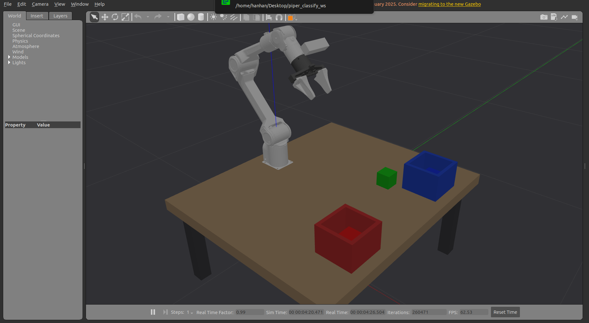

# 当前交接说明 · 2026-10-28

当前状态：新工程共 11 个 ROS 包，新增文本/语音代理和 RobotCommand 服务，已完成本机干净重建及 49 项自动检查（零失败、零跳过）。启动、语言命令和模型配置以 [根 README](../README.md) 为当前入口；本次文件整理、接口恢复和验收边界见 [2026-10-28 发布记录](release_20261028/README.md)。失败/取消/持物后需外部脚本完整重置，成功语言放置可继续发新指令。下方保留各阶段的历史数据与操作详情。

历史状态（2026-10-10）：2026-10-10 已在另一台电脑通过 SSH 排查并修复 RGB-D 传输问题。默认启动自动加载 Fast DDS 每参与者 32 MiB 配置，并识别同一用户的远端桌面。三路图像约 15 Hz、三块完整分拣与手臂/夹爪执行通过；`colcon test-result` 汇总 32 项、零失败。修复还使关节验证工具等待真实反馈后记录返回位姿，并检查全部 6 个关节。详细证据、备份和最终停止状态见 [远端部署修复](remote_deployment_20261010/README.md)，SSH 诊断入口见 [doctor 说明](../doctor_使用与交付说明.md)。历史收尾见 [收尾记录](closeout_20261002/README.md)。下方原始验收数字属于 2026-10-01/02 的历史记录。

基线自动分拣已完成：相机确认红、蓝块位置，MTC 规划并执行抓放，分别进入对应料盒；绿块保持原位，反馈 0/2→1/2→2/2，返回 HOME。四轮 Gazebo 闭环通过，包含红块移位测试。最终 GUI 轮耗时 85.08 s、绿块位移 0.008 mm。9 包构建完成；本轮受影响包复编通过，当前回归为 20 tests 无失败。**用户已反馈当前项目无问题，本阶段已收尾；重置修复有实测记录**。证据和限制见 [自动分拣报告](task_20261001/README.md)。

## 语言指令（2026-10-19）

新增 `classify_agent` 与 `/classify/command` 服务，支持文本/语音 → 大模型解析 → 结构化任务 → 现有 MTC 执行。仿真启动后另开终端：

```bash
cd ~/piper_classify_ws
source /opt/ros/humble/setup.bash
source install/local_setup.bash
source scripts/tools/runtime_env.sh
export ROS_DOMAIN_ID=42
bash scripts/run_agent.sh
```

默认只使用规则解析。LLM 需要使用者在自己的本地 `.env` 中填写密钥，并加 `--ros-args -p use_llm:=true` 显式启用；接入其他服务也可指定端点、模型和密钥环境变量，见 [根 README](../README.md#文本与语音代理)。真实 Key 不进入仓库。

支持“把红色方块放到蓝色盒子里”“拿一个蓝色方块”“桌上有几个红块”“拿左边的红块”“回家/停止/扫描”。语音模式加 `--ros-args -p use_voice:=true`，然后在提示符输入 `voice`。大模型只输出 `intent/colors/quantity/target_bin/selector`，不允许输出关节角或任意坐标；颜色、目标盒、数量、选择器均经过校验。绿色仍是参考物，任何搬绿块请求会被拒绝。`pick_hold` 结束后状态为 `HOLDING`，再次操作前必须重置。详见 [语言演示说明](agent_demo_20261019/README.md)。

原有 `/classify/start` 三块/五块基线行为保持不变；新增命令路径只扩展了 `classify_task` 的参数化能力和 `classify_interfaces/srv/RobotCommand.srv`。



## 启动和触发

GitHub 发布时已清理 build/install/log；首次下载或本机清理后，请先按 [根目录 README](../README.md#首次下载与构建) 完成构建。若画面已经显示 DONE 2/2，先停止再启动恢复初始物块。一个终端启动全部组件：

```bash
cd /home/hanhan/Desktop/piper_classify_ws
bash scripts/reset_classify.sh
```

默认不自动运动。等三个控制器 active、RViz 显示 VISION_READY 后，第二个终端：

```bash
cd /home/hanhan/Desktop/piper_classify_ws
source /opt/ros/humble/setup.bash
source install/local_setup.bash
source scripts/tools/runtime_env.sh
export ROS_DOMAIN_ID=42
ros2 service call /classify/scene_ready std_srvs/srv/Trigger '{}'
ros2 service call /classify/start std_srvs/srv/Trigger '{}'
```

start 返回任务是否接收，最终成功与否看 result。任务运行中或物块已入盒时拒绝重复启动；一次约 80–90 s。主终端依次输出 VISION_TARGET、PHYSICAL_LIFT_OK、PHYSICAL_PLACE_OK、PROGRESS 1/2、2/2、CLASSIFICATION_RESULT。

可选参数：`--auto-start` 自动触发，`--headless` 关闭图形界面，`--plan-only` 仅规划（仍需触发，不执行）。规划预览不能当物理抓放验收。

## 进度、夹爪、相机

在已加载 ROS/工作区并设置 domain 42 的终端：

```bash
ros2 topic echo /classify/status classify_interfaces/msg/TaskStatus --qos-durability transient_local
```

state/stage 为阶段，completed/total 为进度。gripper_open_ratio 来源于实际 joint7（0 闭、1 全开），held_object 来源于 Gazebo 实际双指夹持约束。最终结果另开终端：

```bash
ros2 topic echo /classify/result classify_interfaces/msg/TaskResult --qos-durability transient_local
```

相机画面：

```bash
ros2 run rqt_image_view rqt_image_view /camera/color/image_raw
```

窗口可选 `/camera/depth/image_raw` 查看 RGB 对齐深度。入盒红/蓝已离开取料区，检测只剩绿块正常；场景桥保留实际落盒位置并标 PLACED。scene_status.ready 只要求绿块及剩余待抓对象新鲜，stale_colors 可包含已经入盒的红/蓝。运动、遮挡或短暂断流仍如实显示 VISION_UNAVAILABLE/LAST_SEEN，不把历史坐标当新观测。

## RViz 手动控制和 MTC

左侧 MotionPlanning 与 Motion Planning Tasks 为页签。手动控制切换到 MotionPlanning，选 arm、起点 Current State，在 Joints 设置小幅目标，先 Plan 再 Execute；home 为 `[0,50,−70,0,约70,0]°`。

夹爪选 gripper，目标 open 或 closed，Plan → Execute。全开 joint7=+0.035 m、joint8=−0.035 m，空夹爪闭合为 ±0.0005 m。任务执行时不要同时手动下发运动，两者使用同一控制器。

Motion Planning Tasks 显示每件 MTC 的阶段与解，订阅 `/classify_mtc/solution`。预览 Robot/Scene/Markers 默认隐藏，避免重叠；需要轨迹预览时在 Displays → MTC task solutions 启用对应项。当前环境由 MotionPlanning → Scene Geometry 显示，视觉和任务文字由 MarkerArray 图层显示。RViz 材质与 Gazebo 不完全相同，落盒判定看 Gazebo 实体和记录。

## 停止、取消、重跑

主终端 Ctrl+C 或 `bash scripts/stop_classify.sh` 停止本工作区拥有的启动进程组，包括启动程序已退出、PID 文件缺失时残留的 Gazebo。重置执行 `bash scripts/reset_classify.sh`：等待进程组完全退出后重新加载初始 world，物块、任务状态与计数一并重建；默认不自动分拣。不要只重启任务节点，以免对象所有权记录与实体不同步。

任务中请求取消：

```bash
ros2 service call /classify/cancel std_srvs/srv/Trigger '{}'
```

请求停止控制器，保留夹爪；持物时不自动张开或回 HOME。取消等待和持物取消已在第一阶段覆盖，恢复用停止并重建仿真。异常规划/执行/夹持核对失败会显示 FAILED，不继续搬运。

## 配置与验证

世界坐标、米：基座 z=0.347，桌面 z=0.350、yaw=−π/2，范围 x∈[−0.10,0.62]、y∈[−0.42,0.42]。红/绿/蓝初始为 `(0.40,0,0.375)`、`(0.40,0.14,0.375)`、`(0.40,−0.14,0.375)`；红/蓝盒为 `(0.52,−0.22,0.350)`、`(0.52,0.22,0.350)`。视觉输出 base_link，初始块中心 z≈0.028。

| 配置 | 用途 |
|---|---|
| `src/description/classify_description/worlds/classify.world` | 初始物块和固定设施，场景桥同源读取 |
| `src/description/classify_description/config/workcell.yaml` | 共用取料范围和桌面高度 |
| `src/description/classify_description/config/gemini335.yaml` | 相机光学参数、手眼安装和帧定义 |
| `src/task/classify_task/config/task.yaml` | TCP、倾角、速度、抬升/释放高度 |

现行 TCP 为法兰 +Z 0.132 m，抓取/抬升倾斜 30°、搬运/入盒 45°。改变位置、尺寸或姿态须重新检查视野、取料区、碰撞和轨迹。当前视觉针对 50 mm 方块；基线、移位和新五块布局通过，不能外推任意工作区。旧 check_ik.py、measure_scene.py、开发 probe_task_ik.py 不作为最终可达性依据。

重新构建时先停止本工作区仿真以减轻内存压力：

```bash
cd /home/hanhan/Desktop/piper_classify_ws
source /opt/ros/humble/setup.bash
# 没有 install 时必须先建立描述包索引
CMAKE_BUILD_PARALLEL_LEVEL=1 colcon build --packages-up-to classify_description --symlink-install --executor sequential
bash scripts/tools/build_urdf.sh
CMAKE_BUILD_PARALLEL_LEVEL=1 colcon build --symlink-install --executor sequential
source install/local_setup.bash
source scripts/tools/runtime_env.sh
python3 scripts/tools/check_scene.py
python3 scripts/tools/verify_camera_model.py
colcon test --packages-select classify_perception classify_camera_sim classify_scene_bridge classify_task
colcon test-result --verbose
```

实体闭环检查在全新、未触发任务的仿真中运行，输出目录须不存在；工具会触发运动：

```bash
export ROS_DOMAIN_ID=42
python3 scripts/tools/verify_task.py --output docs/task_local_check
```

添加 --displace 会先移动红块 x−18 mm、y+30 mm，验证视觉跟随；只有测试工具使用真值移动。产品取料坐标来自相机。

旧三终端 run_sim.sh --gui、run_perception.sh、run_moveit.sh --rviz 保留，另运行 run_task.sh 启动任务。不要与完整启动在同一 DDS domain 混用；旧模式仿真用 stop_sim.sh 停止。

## 仿真与实机边界

Gemini 335 按真机项目 RGB/Depth 640×480/15 fps，官方 RGB 70°×55°；保存的完整 link6→RGB optical 手眼矩阵和用户后移布局保留。本轮只调整 Gazebo 查看视角和 RViz 布局，没有放大传感器视场。详见 [相机模型](gemini335_20261001/README.md) 与 [视场复核](gemini335_fov_20261001/README.md)。

实际相机尚未连接，单位设备 K/D、depth→RGB 外参、原始手眼 JSON、真实 TCP 未测量。双指持续接触后固定约束、张开释放是理想夹持近似，不模拟真实滑移、力或柔性。误差与成功次数均是仿真结果；未运行真机，未修改 toy_pick_ws。仿真主流程已经用户运行确认；重启、遮挡、视觉超时和取消恢复补测已完成，本阶段已收到用户整体确认并收尾。实机接入和力/标定验收是后续阶段。

2026-10-01 重启修复：上一轮 ros2 launch 退出后残留 gzserver，PID 文件缺失导致旧 stop 脚本跳过清理。现行生命周期工具按工作区环境标识恢复所有权、串行化启动/停止，并阻止旧 EXIT trap 操作新启动。已验证基线重置及缺失 PID 记录的停止路径，见 [重置验证](reset_20261001/README.md)。

## 2026-10-02 · 复杂场景和传感器压力模式

新增场景包含红/蓝位置扰动、两处灰色静态障碍、降低定向光亮度；障碍同时进入 MoveIt 碰撞场景。带噪版本的深度进入 D2C 前加入 1 mm 标准差和 5% 缺失，这是压力参数，不是单位 Gemini 实测噪声。默认模式仍关闭压力输入。

已生成并实际验证的场景可直接启动（自动分拣）：

```bash
cd /home/hanhan/Desktop/piper_classify_ws
bash scripts/reset_classify.sh --world docs/robustness_20261002/clutter_seed7.world --sensor-stress --seed 7 --auto-start
```

想先看初始场景，去掉 --auto-start；只测试障碍/位置扰动，去掉 --sensor-stress。回基线：`bash scripts/reset_classify.sh`。全部退出用 `bash scripts/stop_classify.sh`。

正常分拣四轮与防护/恢复四项已通过，包括物理遮挡时无运动目标、视觉超时后拒绝重跑、持物取消后保持夹爪、重置清除附着和结果。取消/失败后 **start 会明确拒绝**，必须完整重置；相机恢复不表示可以跳过重置。

本轮新工具：make_scenario.py（独立场景生成）、verify_robustness.py（完整试验）、capture_camera_reference.py（保存单位 CameraInfo/RGB-D/图像时刻 TF）。详细命令、接受与历史失败区别、图片和实机缺项见 [阶段报告](robustness_20261002/README.md)。该阶段当时仅每色一个 50 mm 方块；灰色障碍不抓取，绿块不动。下方 S9 已补齐同色多块、朝向与料盒槽位。执行验证仍依赖 Gazebo，采集入口不等于已实现真机执行后端。

## 同色多块阶段：五块验收

已加入两红、两蓝、一绿的独立场景，实体闭环/遮挡恢复/容量拒绝/基线回归已通过，最终 GUI 压力回归通过。直接使用保存的场景，不会覆盖已验收三块 world：

```bash
cd /home/hanhan/Desktop/piper_classify_ws
bash scripts/reset_classify.sh --world docs/multi_object_20261002/multi_v3_seed11.world
```

等五块标出独立 ID、VISION_READY 后，在已 source 工作区且 domain=42 的第二个终端调用上面的 `/classify/start`。进度为 0/4→1/4→2/4→3/4→4/4，约 3 分钟；两红分别进入红盒槽位，两蓝分别进入蓝盒槽位，绿块原位，机械臂回 HOME。可先用 `--plan-only` 预览，也可添加 `--auto-start`。

自行生成另一组微扰/朝向场景（输出路径必须不存在）：

```bash
python3 scripts/tools/make_scenario.py --profile multi --seed 11 --output /tmp/piper_multi11.world
bash scripts/reset_classify.sh --world /tmp/piper_multi11.world
```

需要压力输入时加 `--sensor-stress --seed 11`，默认关闭；这不是实测 Gemini 误差模型。回到三块基线用 `bash scripts/reset_classify.sh`，关闭用 `bash scripts/stop_classify.sh`。每次 reset 都须重新给 `--world`，不会自动记住上次模式。

取料 X 范围扩至 0.30..0.55 m，以覆盖后排 x≈0.50 m 方块旋转后的顶面；Y 仍为 ±0.20 m。只修改新增场景的布局和盒体，基线 world、HOME、Gemini 内参/手眼保持原值。两料盒新外宽 0.20 m、内宽 0.176 m、中心 `(0.52,±0.27,0.35)`；槽位按实际盒壁算出，世界 X≈0.485/0.555 m。

`SceneStatus.object_ids/object_colors` 为平行数组，`fresh_objects/stale_objects` 是逐件观测状态；已放件可 stale 而 ready=true。`TaskStatus.current_object/placed_objects` 与 `TaskResult.objects` 是视觉 ID，不再是颜色名。`held_object` 和结果 `physical_objects` 是实际夹持模型名，可能与视觉 ID 不同，禁止用二者名字相等作为定位依据。消息定义已扩展，外部客户端须重新编译；启动完整系统会使用当前接口。

支持水平桌面、已知 50 mm 方块；yaw 是正方形模 90° 的边方向，非唯一 360° 朝向。预期件数从 world 的 `red_block/blue_block/green_block` 及数字后缀清单取得，不读取取料真值 XYZ；当前要求恰好一件绿色参考。视觉超过清单数量、未确认、超时或关联歧义均拒绝就绪。算法最多为每色分配四个地面槽位，但本轮实际只验证每色两件，容量足够不代表任何布局都可达。

保持同色对象不交叉/不交换位置；遮挡恢复与小幅位移可追踪，距离关联门限 45 mm、近似等距歧义会拒绝。大幅位移或遮挡期间身份无法确定时应重置并重新确认。未知障碍/任意形状/堆叠/真实夹持反馈仍待后续阶段；真实设备 K/D、手眼残差和 TCP 仍缺单位实测。证据见 [同色多块报告](multi_object_20261002/README.md)。
