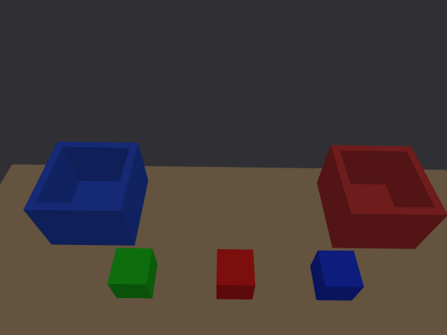

> 后续视场专项核对见 [2026-10-01 复核](../gemini335_fov_20261001/README.md)。最终默认仍匹配真机项目 640×480/15 fps，未把它替换为宽屏档位。

> GitHub 发布说明：本报告原始 `.npz` 帧已移入工作区外的本机归档，未随仓库上传；JSON、报告和截图保留。离线回放需恢复原始帧或重新采集。见 [清理记录](../github_20261002/README.md)。

# Gemini 335、手眼参考与后移布局 · 2026-10-01

本次按用户要求完成相机模型及视觉链路更改，保留用户后移的物块和料盒位置。HOME RGB 画面已实际采集，多位姿定位、红块真实位移和过期保护均已验证。此报告是相机阶段记录；之后 S5/S6 自动抓放已完成，见 [最新闭环报告](../task_20261001/README.md)。



## 参数依据与可信范围

使用 **Gemini 335 USB**，不是 335L。资料查阅日期为 2026-10-01：

- [Orbbec 官方产品页](https://store.orbbec.com/products/gemini-335)：外形、重量、基线、RGB 4:3 视场及快门类型。
- [官方 Datasheet 索引](https://doc.orbbec.com/documentation/Orbbec%20Gemini%20330%20Series%20Documentation/Gemini%20330%20Series%20Datasheet%20(Overall)) → [USB V1.7 PDF](https://orbbec-debian-repos-aws.s3.amazonaws.com/product/Gemini%20330%20series%20Datasheet-V1.7.pdf)，4.5.2/4.5.3 的典型内参、对应分辨率视场，4.7 的 MinZ。另核对 [官方 V1.6 PDF](https://www.orbbec.com/wp-content/uploads/2025/06/Gemini-330-series-Datasheet-V1.6.pdf)。
- [官方坐标系说明](https://doc.orbbec.com/documentation/Orbbec%20Gemini%20330%20Series%20Documentation/Coordinate%20Systems%20(Stereo%20Vision%203D%20Camera))：深度光心是左 IR；光学坐标 X 右、Y 下、Z 前；335 的 RGB 光心相对深度光心为 `(14,0,2.02) mm`。
- [官方 ROS2 D2C](https://doc.orbbec.com/documentation/Orbbec%20Gemini%20330%20Series%20Documentation/ROS2%20Tutorial%20Depth%20%26%20Color%20Alignment)：`depth_registration:=true`。
- 本机 `toy_pick_ws` 的 `grasp_config.py`、`visual_grasp.py`、`depth_localizer.py`、`hand_eye_tf_publisher.py` 和相机 launch，均只读参考，没有改动真机工作区。

| 项目 | 本次模型 | 来源/限制 |
|---|---|---|
| RGB/原生深度 | 640×480，15 fps | 与真机工作区 launch 一致；Gazebo 时间步量化后典型间隔 67 ms |
| RGB 视场 | 70°×55° | 官方 4:3 标称值；并非 16:9 的 86° 水平值 |
| RGB K | fx=457.007362，fy=461.035710，cx=320，cy=240 | 从标称视场计算；不是这台设备的工厂内参 |
| 原生深度 K | fx=fy=372，cx=320，cy=240 | 官方典型 640×480 内参；约 81°×65°，会随有效重叠和距离变化 |
| 原生深度 MinZ | 0.17 m | 640×480 档位的典型值；不把产品总量程下限直接当作该档位 MinZ |
| 双目基线 | 50 mm | 仅模拟近端左边缘的双目重叠损失 |
| RGB 相对深度光心 | (0.014,0,0.00202) m | 官方标称平移；两光学系相对旋转暂按单位矩阵 |
| 外壳 | 90×25×30 mm、97 g | 尺寸/质量为官方数据；碰撞体为近似盒，惯量为均匀盒估算 |
| 畸变 | 仿真 D=0 | 无此设备 CameraInfo 记录；检测节点支持读取真实 D 并去畸变射线 |

目前机器未连接 Gemini 335，真机工作区也没有找到保存的 RGB CameraInfo、设备标定内参或原始手眼 JSON。因此这里使用的是**官方标称传感器几何 + 真机项目实际保存的手眼参数**；不能将仿真的毫米级误差表述成真机精度。滚动快门、双目匹配、硬件补洞、MJPG 压缩和经验噪声尚未建模，也没有凭空指定噪声幅度。后续接上实际设备，读取同档位 CameraInfo 与设备 extrinsics 后才能进一步收敛差异。

## 手眼矩阵与坐标约定

参考文件：`~/Desktop/toy_pick_ws/src/perception/toy_grasp/toy_grasp/grasp_config.py`。记录标定日期 2026-06-22、31 次采集：

```text
P_link6 = T_link6_color_optical × P_color_optical
xyz (m) = [-0.09294, 0.01914, 0.02915]
rpy (rad) = [-0.05907, 0.00275, -1.58335]
R = Rz(yaw) Ry(pitch) Rx(roll)
```

`visual_grasp.py` 将 RGB 像素/对齐深度反投影的光学 XYZ 直接乘 `T_CAM_EE`，因此本次按 **RGB 光学系 → link6** 使用该矩阵。这是根据真实运行代码推断的语义。参考 `hand_eye_tf_publisher.py` 却把同一矩阵的子系命名为 `camera_link`，名称与光学语义不一致；本次没有机械照抄这个名称，也没有在手眼矩阵后额外重复旋转光学轴。

原始 `result/2026-06-22_18-56-28_calibration.json` 未找到，无法独立复核 31 组采样、残差和标定不确定度。参考源文件副本及其 SHA256 保存于 `reference/` 与配置中，便于追溯。

相机链采用 Orbbec ROS 的外壳轴约定：`body → optical` 为 RPY `(-π/2,0,-π/2)`。由已知 RGB 光学矩阵与光心偏移反推 `link6 → camera_link`，外壳原点放在左 IR。静态 URDF 和运行时 TF 均验证复合后恢复上面的完整参考矩阵；`camera_color_optical_frame` 和 `camera_depth_optical_frame` 独立，旧 `camera_optical_frame` 只是 RGB 光学系的同位别名。

不要再通过随意改 `link6_to_camera` 的 RPY 来追求某个姿态下的画面。保持真机安装变换，通过手臂的观察姿态获得需要的视野；换实际安装支架或光心位置后应重新标定。

## 实现与维护入口

- `src/description/classify_description/config/gemini335.yaml`：手眼参考、原生 RGB/深度 K、档位、标称光心偏移及来源。
- `scripts/tools/import_hand_eye.py`：用 AST 读取真机参数，自动推导外壳姿态和平移，不执行、不修改真机代码。改参考参数后运行此工具，然后重新生成 URDF。
- xacro 的两个 Gazebo 传感器分别模拟 RGB 和左 IR 原生深度，使用 `<camera><lens><intrinsics>` 设置实际渲染矩阵，不能只改变 CameraInfo。
- 新 C++ 包 `classify_camera_sim` 将原生深度反投影、变换到 RGB、投影并以最近深度解决重叠，输出与真实驱动一致的 **RGB 对齐 16UC1 毫米深度，0 为无效值**。原生 Gazebo 深度为 32FC1 米。
- Gazebo ROS 相机插件的 CameraInfo 使用简化的焦距计算，会忽略自定义 fy 并出现半像素主点差。因此其信息改名为 `*/gazebo_camera_info`，C++ 适配器发布与实际镜头矩阵一致的规范 CameraInfo。
- [Gazebo 相机实现](https://github.com/gazebosim/gazebo-classic/blob/gazebo11/gazebo/rendering/Camera.cc) 和 [ROS 插件实现](https://github.com/ros-simulation/gazebo_ros_pkgs/blob/ros2/gazebo_plugins/src/gazebo_ros_camera.cpp) 是上述处理的依据。
- `workcell.yaml` 共用取料过滤区域：base 系 x∈(0.30,0.45)、|y|<0.20，50 mm 方块，桌面 base z=0.003。检测节点和场景桥共同加载。
- MoveIt 的固定桌子/料盒碰撞体改为从 **同一个 `classify.world`** 读取；修改位置后重启 MoveIt，不必再手动复制料盒坐标到 C++。

### 规范话题

| 话题 | 用法 |
|---|---|
| `/camera/color/image_raw` | RGB 原图，rgb8 |
| `/camera/color/camera_info` | RGB 内参 |
| `/camera/depth/image_raw` | D2C 对齐深度，16UC1 mm，RGB 光学系 |
| `/camera/depth/camera_info` | D2C 内参，与 RGB 相同 |
| `/camera/native/depth/image_raw` | 仿真原生左 IR 深度，32FC1 m，深度光学系 |
| `/camera/native/depth/camera_info` | 原生深度内参 |

旧 `/wrist_depth_sensor/image_raw`、`/wrist_depth_sensor/depth/image_raw`、`/wrist_depth_sensor/camera_info` 保留兼容别名。其深度现在也是毫米 16UC1。诊断用 `gazebo_camera_info` 和原生 `/camera/native/points` 不用于本项目定位。

## 后移布局

以下为世界坐标，单位米；基座仍为 `(0,0,0.347)`，桌面 z=0.35，桌子 yaw=−π/2：

| 模型 | 当前位置 |
|---|---|
| 红块 | (0.40,0,0.375) |
| 绿块 | (0.40,0.14,0.375) |
| 蓝块 | (0.40,−0.14,0.375) |
| 红盒 | (0.52,−0.22,0.350) |
| 蓝盒 | (0.52,0.22,0.350) |

保留用户这次移动的 x 值，均比旧布局远 0.10 m。桌板范围 x∈[−0.10,0.62]、y∈[−0.42,0.42]，两盒底板和四壁仍在桌面范围内，没有互相穿模。视觉产品不读取 Gazebo 模型真值，world 只为固定设施提供规划几何和测试真值。

HOME 时三个物块完整可见；右侧料盒贴近画面边缘。真实标称视场不会保证所有腕部姿态都能看见全部场景。本轮 `joint5 −0.18 rad` 测试部分顶面不完整，`joint1 +0.75 rad` 部分物块离开视野，均显示不可用并保留历史位置，回 HOME 恢复。之后的自动任务需回到观察姿态获取新鲜坐标。新布局下的抓取/入盒轨迹尚未验证，不把静态距离检查当作完整抓放可达证据。

## 实测证据

| 检查 | 结果 |
|---|---|
| 六个包构建 | 通过；`log/gemini335_final_build.log` |
| C++ 测试 | 11 tests、0 failures；含注册平移/单位、近端重叠、前景深度、顶面和场景确认 |
| URDF/世界静态检查 | 光学矩阵一致；桌板 1、腿 4、每盒 5 个碰撞体，后移工件均在取料区 |
| 实际相机话题/TF | RGB/原生深度/D2C 编码、K、光学系及同帧配对通过；[JSON](camera_live.json) |
| 多位姿 | [172 对 RGB-D/TF 与日志](live_motion/record.json)，可靠中心最大误差 1.226 mm，规划场景最大误差 1.163 mm |
| 红块真实位移 | x−0.02、y+0.035；更新误差 0.814 mm，已恢复；绿、蓝未移动；[记录](displacement.json) |
| 保护 | 错误单帧不推进位置、旧消息拒绝、暂停时钟后断流超时通过；[记录](guards.json) |

本次测试结束后，已停止本轮仿真、MoveIt 和视觉进程；验收时按下述命令启动。

控制器启动检查另修正为直接查询 `/controller_manager/list_controllers`，避免旧 ROS CLI daemon 的缓存造成“日志已激活但启动脚本报失败”。

### 复测命令

```bash
cd /home/hanhan/Desktop/piper_classify_ws
python3 scripts/tools/import_hand_eye.py
bash scripts/tools/build_urdf.sh
source /opt/ros/humble/setup.bash
colcon build --packages-up-to classify_description classify_moveit_config classify_perception --symlink-install
python3 scripts/tools/check_scene.py
python3 scripts/tools/verify_camera_model.py
colcon test --packages-select classify_camera_sim classify_perception classify_scene_bridge
colcon test-result --verbose
```

启动三个终端分别运行 `bash scripts/run_sim.sh --gui`、`bash scripts/run_perception.sh`、`bash scripts/run_moveit.sh --rviz`。额外终端查看相机：

```bash
cd /home/hanhan/Desktop/piper_classify_ws
source /opt/ros/humble/setup.bash
source install/local_setup.bash
export ROS_DOMAIN_ID=42
ros2 run rqt_image_view rqt_image_view /camera/color/image_raw
```

在查看器选择 **raw**。深度用 `/camera/depth/image_raw`，也选择 raw；不要选择 JPEG compressed 的原生 32FC1 深度。停止按各前台终端 Ctrl+C，然后 `bash scripts/stop_sim.sh`。

运行验证（前三个后端已启动时）：

```bash
source /opt/ros/humble/setup.bash
source install/local_setup.bash
export ROS_DOMAIN_ID=42
python3 scripts/tools/verify_camera_model.py --live --output /tmp/gemini335_camera_check
python3 scripts/tools/verify_perception.py --check --output /tmp/gemini335_motion_check
```

运动工具先检查插值状态的碰撞，再在仿真控制器上执行，最后恢复原姿态；输出目录应为尚不存在的路径。

## 真机接入时剩下的数据

实际 Gemini 335 使用与参考 launch 一致的 640×480/15 fps、`depth_registration:=true`。只运行真实驱动自己的 D2C，不启动仿真适配器。读取相同档位的真实 RGB/深度 CameraInfo 和 depth→RGB extrinsics，再替换标称 K/畸变/相对光心模型；镜头渲染和 CameraInfo 必须同时改。若畸变不为零，还需要匹配的渲染畸变模型，不能仅修改消息中的 D。

检测节点提供 `reference_frame` 与 `optical_frame` 参数，以适配真机的 `piper_base_link` 等名称，并提供 `sync_tolerance`（默认精确同帧，最大 33 ms）。真机是否要用容差应以真实时间戳记录确定，不预先放宽；例如真实 RGB-D 稳态采样差在 20 ms 内时才考虑 `use_sim_time:=false sync_tolerance:=0.02 reference_frame:=piper_base_link`。先确保 `piper_base_link → camera_color_optical_frame` 的 TF 语义正确，测量桌面相对基座高度并调整取料区。这些是后续真机接入准备，不表示本轮已经做过真机精度验收。
