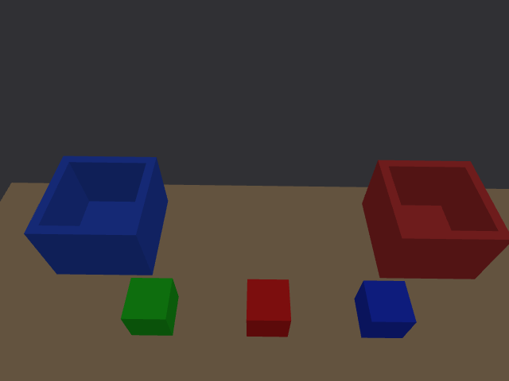

# Gemini 335 视场复核 · 2026-10-01

> 后续自动抓放已完成四轮实体闭环；本报告光学参数保持不变。当前操作与结果见 [分拣报告](../task_20261001/README.md)。

用户反馈实际相机视野似乎比仿真大，并明确要求“按真机项目来”。最终默认仍严格匹配 `toy_pick_ws`：**RGB/原生深度 640×480，15 fps，D2C，RGB 70°×55°**。没有证据支持把此档位直接改成 86°。本次已重新生成模型并实际核验图像投影；感知到的真机范围差异尚未确认原因。



## 官方资料与真机项目核对

本次下载保存 [Orbbec 官方 USB V1.7 数据手册](https://orbbec-debian-repos-aws.s3.amazonaws.com/product/Gemini%20330%20series%20Datasheet-V1.7.pdf)，来自 [官方手册索引](https://doc.orbbec.com/documentation/Orbbec%20Gemini%20330%20Series%20Documentation/Gemini%20330%20Series%20Datasheet%20(Overall))。发布前原文件保存在 `reference/Gemini330_USB_V1.7.pdf`，第 30 页典型深度内参已渲染并人工核对；发布时 PDF 移入本机外部归档，仓库通过上述官方链接获取原文件。当前参数对应表 4-4-1（数据流）、4-5-2（典型深度 K）、4-5-3（分辨率与 FoV）及第 37 页 MinZ。

| 档位 | RGB 视场 | 原生深度典型 K | 深度 MinZ |
|---|---|---|---|
| **当前：640×480、4:3** | **70°×55°** | fx=fy=372，cx=320，cy=240 | 0.17 m |
| 官方可选：640×360、16:9 | 86°×55° | fx=fy=310，cx=320，cy=180 | 0.14 m |

原生深度在 640×480 的标称视场约 81°×65°，与 RGB 的视场不同；D2C 后依赖两视图的有效重叠，不能将原生深度的宽视场当作 RGB 参数。各值是官方标称/典型参数，设备真实 K/D 仍以实际 CameraInfo 为准。

本机真机源文件 `camera_piper.launch.py`、`hardware.launch.py` 和 `correction_test.launch.py` 均配置 RGB/Depth 640×480/15 fps，RGB 格式 MJPG，开启 depth_registration。机械臂六个关节的 origin 与仿真模型逐项对比一致，手眼矩阵亦保留原参考值。

`grasp_config.COLOR_TUNER.full_window_size=(1280,720)` 只指定 `cv2.resizeWindow` 的显示窗口，实际送给 imshow 的图像仍来自原始 RGB。它不是相机采集分辨率，也不会扩大角度视场。未据此认定用户差异的原因。

## 本次具体完善

1. `gemini335.yaml` 明确记录选用的 `rgb_4_3` 档位、官方 URL，以及真机项目记录的 RGB/Depth 档位。
2. 增加 `scripts/tools/select_camera_profile.py`，把图像尺寸、FoV、实际渲染 K、原生深度 K 与 MinZ 作为整体切换，避免改 FOV 元数据却仍加载旧内参。当前设置为 `rgb_4_3`。
3. 验证工具增加 FoV/K 一致性和运行分辨率检查；若忘记重启、仍运行旧模型，会直接报错。
4. 增加独立的渲染投影检查：用 Gazebo 真值中的立方体八角点、图像时刻 TF 和 K 计算预期边界，再与真实 RGB 颜色轮廓的边界比较。Gazebo 真值只用于测试，未接入产品检测。

## 结果

- 六包构建通过，静态手眼矩阵、深度光心偏移、FoV/K 及场景一致性通过。
- 实际 RGB/Depth/D2C 尺寸与配置一致，RGB 与 D2C 对齐、内参发布及三个可靠定位通过。
- 红、绿、蓝的边界最大偏差分别为 **0.825、0.854、1.126 px**；说明当前图像投影与 70°×55° 配置相符，没有发现 Gazebo 额外缩窄。
- 完整数值见 [camera_live.json](camera_live.json)，模型检查见 [camera_static.json](camera_static.json)。这次只读投影核对没有移动三块物块或更改布局。

本轮没有读取实际相机，因此不能证明仿真视场与用户那台设备已完全一致，也不能证明真机当时实际运行的分辨率与源文件配置一致。实际驱动运行档位、设备 K/畸变、观察姿态和相机到桌面的距离，都需要在同一条件下核对。相机安装矩阵和物块/料盒布局未为“看起来更宽”而改动。

## 启动和进一步核对

仿真启动方式仍见 [交接说明](../05_交接说明.md)。停止本工作区运行实例后，分别启动 Gazebo、视觉和 MoveIt，再查看 RGB 原图；rqt_image_view 选择 raw，并检查消息尺寸：

```bash
cd /home/hanhan/Desktop/piper_classify_ws
source /opt/ros/humble/setup.bash
source install/local_setup.bash
export ROS_DOMAIN_ID=42
ros2 topic echo /camera/color/camera_info --once
ros2 run rqt_image_view rqt_image_view /camera/color/image_raw
```

真机相机驱动已经启动时，在它的同一 ROS_DOMAIN_ID 和已加载真机环境的终端执行：

```bash
ros2 topic echo /camera/color/camera_info --once
ros2 topic echo /camera/depth/camera_info --once
```

重点记录 width、height、K 与 D，再按图像实际档位比较。无畸变、主点近中心时，可用 `HFOV≈2 atan(width/(2fx))`、`VFOV≈2 atan(height/(2fy))` 初步核对；有畸变或偏心时还需相应边缘射线计算。查看 RGB 应与仿真 RGB 比，原生深度应与原生深度比。

如果真机项目未来明确换成宽屏，才同步使用官方 16:9 参数；提高像素数量本身不会扩大同一比例档位的 FoV。当前复现 4:3 的生成命令：

```bash
python3 scripts/tools/select_camera_profile.py rgb_4_3
bash scripts/tools/build_urdf.sh
source /opt/ros/humble/setup.bash
colcon build --packages-up-to classify_description classify_moveit_config classify_perception --symlink-install
```

本次独立测试用 ROS_DOMAIN_ID=43、Gazebo master 11355，仅用于检查，用户日常仍使用脚本默认的域 42。
