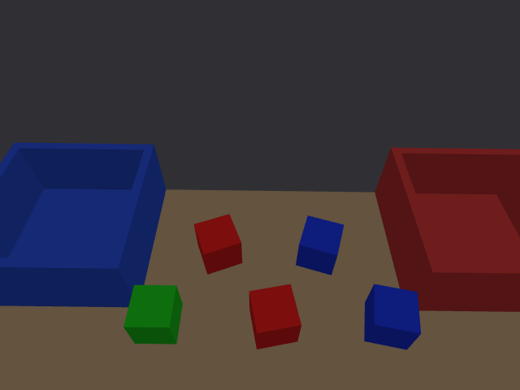
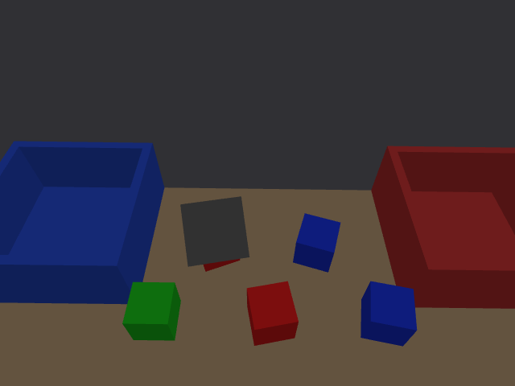

# 同色多块阶段 · 2026-10-02

功能、实体闭环和最终 GUI 压力回归均通过。目标为两红、两蓝、一绿，红入红盒、蓝入蓝盒、绿不动；基线三块 world 不被覆盖。

## 实现

- 感知从“每色最大轮廓一件”改为逐轮廓输出。RGB-D 精确同步、图像时刻 TF、相机静稳、顶面高度/尺寸/平面/网格覆盖率约束保持。最小包围矩形估计方块边方向，中心和面积在旋转后的局部轴上检查，支持水平面内 yaw。模 90°，不宣称正方体唯一朝向。
- 场景桥逐颜色、逐件作 45 mm 空间关联，观测与轨迹最多使用一次，近似等距或重复关联拒绝。位置或 yaw 变化须三帧且至少 0.35 s 确认；遮挡保留 LAST_SEEN，恢复时保持 ID。5 cm 物块之间需要夹爪空间，不能只满足物块互不重叠。
- world 只给固定设施和预期件数，不给任务取料坐标。视觉 ID 如 `red_block_2` 与物理名字独立；只有双指实际夹住后，使用持物反馈绑定模型，核对它与视觉目标一致，再检查实际抬升/落盒。
- 启动运动前为所有目标预留槽位。内边界从底板和四壁计算，槽位中心距 70 mm、设计墙边余量至少 10 mm；不足则拒绝。放置检查完整旋转方块的八角点在盒内（墙边 1 mm、底板 2 mm 数值容差），并对同盒已放件做分离轴检查，至少 2 mm 间距。批次末再检查全体实际方块，并同步最终姿态。
- 稳定画面中件数超过清单同样拒绝，不能因追踪数量上限而悄悄忽略额外目标。图像领先最新 `/clock` 的 50 ms 内小量容差与已有接收规则一致，超过容差仍无效，断流过期仍为 0.8 s。

## 场景与命令

新场景五块初始中心分为 x≈0.40/0.50 m 两排，微扰 ±1 mm、yaw 微扰 ±1°，红/蓝边方向约 12°/22°、−10°/−18°；绿块完全沿用基线。新料盒外宽 0.20 m、内宽 0.176 m，中心 world `(0.52,±0.27,0.35)`。槽位 world X 为约 0.485/0.555 m，Y 为 ±0.27 m。

取料 X 上限扩至 0.55 m，覆盖旋转后顶面；相机内参、手眼、安装、HOME 和基线 world 不变。盒内方块的顶面高于桌面方块模型约 12 mm，仍被桌面顶面高度约束排除。

```bash
cd /home/hanhan/Desktop/piper_classify_ws
bash scripts/reset_classify.sh --world docs/multi_object_20261002/multi_v3_seed11.world
```

默认先显示 Gazebo/RViz，不自动运动。第二个终端 source 工作区、设置 domain 42，等待 VISION_READY 后：

```bash
source /opt/ros/humble/setup.bash
source install/local_setup.bash
export ROS_DOMAIN_ID=42
ros2 service call /classify/scene_ready std_srvs/srv/Trigger '{}'
ros2 service call /classify/start std_srvs/srv/Trigger '{}'
```

完整批次约 3 分钟，4/4 后回 HOME。重跑同场景须再次 reset 并指定 world；恢复基线只用 `bash scripts/reset_classify.sh`。生成工具支持 `--profile multi --seed N --output 新路径`；压力模式 `--sensor-stress --seed N` 可关闭，默认关闭。

## 接口和边界

新 `DetectedBlock.yaw` 为 base_link 中弧度边方向；`SceneStatus.object_ids/object_colors` 平行，fresh/stale 按 ID 报告。任务 current_object/placed_objects/result.objects 改用视觉 ID，结果新增 physical_objects 用于仿真验证溯源。老客户端须重编译自定义接口。

验证只覆盖每色两件 50 mm 方块、单件绿色参考、当前记录中的水平面朝向和布局。每色最多四个槽位是几何容量，不是四件任意排布可达的验证。距离关联无法解决同色对象在遮挡期间交换位置；歧义应拒绝并重置，尚非任意目标识别或长期完整追踪。未知障碍、反光/无纹理误差、非方块、堆叠和设备特定畸变未实现。

夹持仍是双指接触后的理想约束，TCP 0.132 m 是仿真设计值。深度压力模式为 1 mm 独立高斯标准差与 5% 缺失，不是 Gemini 单位设备测量。未采到真实单位相机 K/D、手眼残差、真实 TCP、物块质量/惯量/摩擦或力/滑移数据；真机工作区只读未改，本阶段不能宣称真机仿真差异已消除。

## 验证

核心回归 20 tests、0 errors、0 failures（包含 CTest 汇总和 GTest，非 20 个独立物理场景）。最终接受汇总见 [accepted_summary.json](accepted_summary.json)，5 项接受记录：3 轮实体抓放、2 项拒绝；同色单件遮挡/恢复合并在正常多块轮内。

| 检查 | 结果 | 证据 |
|---|---|---|
| 常规五块 seed 11 + 单件遮挡恢复 | 162.572 s，4/4，绿位移 0.007817 mm；只遮住一件红块，另一红块新鲜，恢复无重复/换号 | [record](batch_b/record.json) |
| 最终 GUI 五块 seed 7 + 深度压力 | 168.579 s，4/4，绿采样位移 0 mm；全部独立落盒，回 HOME | [record](gui_stress/record.json) |
| 原三块基线回归 | 84.183 s，2/2，绿位移 0.007814 mm，MTC/夹爪反馈/回 HOME 通过 | [record](baseline/record.json) |
| 原小盒装两件/色 | 0.138 s 内拒绝，0 件搬运，FAILED，重跑锁定，关节/实体未发生显著变化 | [record](capacity/record.json) |
| 视觉比清单多一件红块 | 不就绪，任务停留检测等待；无手臂目标，3 s 后取消，failed=0，重跑锁定 | [record](inventory/record.json) |

两轮正式多块验收初始视觉中心最大误差 1.042 mm、模 90° yaw 最大误差 0.256°；这是这些仿真初始观测样本，不是整个工作区或真机精度。入盒姿态由物理验证同步，不能把其近零场景差当成视觉误差。各记录独立检查模型/视觉身份绑定、完整角点位于盒内、同色已放件不重叠、0/4→4/4、无附着残留和回 HOME。

最终构建见 [初次构建](build.log)、[任务与追踪修订](build_v2.log)、[最终场景桥](build_inventory_guard.log)。初次含外部 Gazebo CMake 警告、未使用的并行参数警告及自身缩进警告；自身警告已修正，后续受影响包构建通过。最终核心检查见 [tests_final.log](tests_final.log)、[test_result.txt](test_result.txt)，基线静态几何/相机核对见 [check_scene.txt](check_scene.txt)、[check_camera.txt](check_camera.txt)。启动/停止 shell、相关 launch/工具 Python 语法通过，测试仿真已关闭。

首个成功试跑 batch_a 为 162.604 s、4/4、绿采样位移 0 mm；当时取料 X 上限为 0.525 m，因此只作开发记录，不计上述最终接受汇总。所有诊断失败的文件保留，不将失败 trial 列为成功。





早期近排 x≈0.33 m 被 RGB 下沿裁切；移至 x≈0.38 m 后，张开夹爪与邻件发生真实规划碰撞。均在运动前拒绝，相关 trial/final_a 与 approach 诊断日志保留，不列成功验收。batch_a 首次成功但使用此前 X 上限 0.525 m；最终采用 0.55 m，避免旋转顶面边角被取料范围截掉。

## 收尾状态

2026-10-02 用户反馈“目前该项目没什么问题”，要求先完成收尾、后续另行下达新任务。本阶段已收尾，保留既有实测与支持边界，不将这次反馈记作新增独立运行或真机验收。仿真已停止，当前运行代码和配置保持。源码快照与文件校验清单见 [收尾记录](../closeout_20261002/README.md)。后续扩展等待用户新要求。
