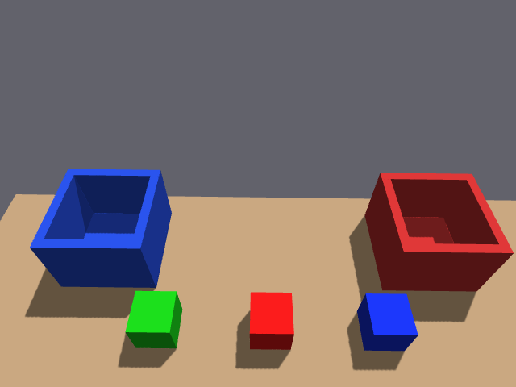

# SSH 部署修复与真实远端验收 · 2026-10-10

本次通过用户授权的免密 SSH 在另一台电脑完成排查、修复和运行验证；修复文件同时保存在本机工作区。相机与基线/扩展分拣均通过，交付时测试仿真已停止。

## 环境与根因

远端：Ubuntu 22.04.5、内核 6.8.0-138、ROS 2 Humble、Gazebo Classic 11.10.2、RTX 4060 Laptop、NVIDIA 580.178.04、Fast DDS 2.6.12 / rmw_fastrtps_cpp 6.2.10。工作区 `~/piper_classify_ws`，ROS_DOMAIN_ID=42；桌面由同一用户登录，SSH 本身未继承 DISPLAY/XAUTHORITY。

最初“控制器 active、相机零帧”并不足以归因于渲染失败或缓存损坏。旧 OGRE 日志已有 NVIDIA 渲染记录；在显式验证相同 NVIDIA/GLX 环境后，仅改变 DDS 共享内存段配置进行对照：

| 对照 | RGB Hz | 原生深度 Hz | 对齐深度 Hz | RTF | 场景 |
| --- | ---: | ---: | ---: | ---: | --- |
| Fast DDS 默认内建传输 | 0.08 | 0.33 | 0 | 0.999 | 无同步观测，未就绪 |
| SHM 每参与者 32 MiB + UDP | 14.99 | 14.90 | 14.90 | 0.998 | 3 块，ready=True |
| 修复后普通 SSH 默认启动 | 14.98 | 14.90 | 14.98 | 0.999 | 3 块，ready=True |

对照日志：[默认传输](dds_default.log)、[32 MiB 配置](dds_32mib.log)、[普通 SSH 自动环境](ssh_default.log)。前两轮使用诊断版本 `.2`；第三轮使用交付版 `2026-10-10.3`。

根因为默认小共享内存段限制了大图像传输。[Fast DDS 2.6 官方说明](https://fast-dds.docs.eprosima.com/en/2.6.x/fastdds/transport/shared_memory/shared_memory.html) 给出默认段大小 512 KiB，并提醒段大小过小会丢数据。本项目每帧 RGB 约 0.9 MB、原生深度约 1.2 MB。整个 `/dev/shm` 原本约 16 GB 且空闲充足；本次没有重新挂载、缩容或通配删除共享内存文件。

## 修复内容

- 新增 [Fast DDS 配置](../../scripts/config/fastdds_local.xml)：显式 SHM 32 MiB，保留 UDP。
- 新增 [运行环境辅助脚本](../../scripts/tools/runtime_env.sh)，接入完整启动、拆分启动和手臂/夹爪验证入口。没有显式 DDS 配置时使用项目配置；SSH 中尝试同一用户 GNOME/Xwayland 的本地显示会话，并通过 GLX 验证。保留用户显式选择，只调整当前进程环境。
- 更新 [doctor.sh](../../doctor.sh)：默认复用已有完整仿真；显式 `--stop-existing` 才停止它；只清理自己启动的测试进程。检查真实 renderer、图像属性/首尾间隔、时钟实时率、新鲜检测与 scene_ready；失败返回非零。不会修改 bashrc/fstab、安装软件或删除 SHM 文件。
- 移除远端旧 doctor 写入 bashrc 的 `piper_doctor` 强制 UDP 标记块。先备份，保留其他用户设置和旧 XML。已经打开的旧终端仍可能保留旧环境变量，重新开 SSH 会话即可；手动配置的其他 profile 仍由用户管理。
- 修复关节验证工具：等待真实关节状态后记录返回目标，检查全部 6 个关节恢复。旧工具在新状态监视器尚未收到首帧时可能记录全零默认值；本次实测复现，修复后返回原姿态通过。
- 整理描述包两个 launch 文件的许可证说明、模块文档和格式，使原有 lint 检查通过。执行部分 AST 与原版本一致；不改变启动行为或传感器参数。

相机参数/手眼矩阵、物块与料盒布局、视觉和抓放算法、驱动均未更改。远端原有 `docs/gemini335_20261001/camera_static.json` 浮点记录差异保留。

## 验收结果

| 验证 | 结果 | 证据 |
| --- | --- | --- |
| 普通 SSH 启动在线检查 | 自动选 NVIDIA/GLX，三路约 15 Hz，3 块，PASS、零警告/失败 | [doctor 日志](ssh_default.log) |
| MoveIt 手臂执行 | joint1 增加 0.08 rad，执行成功，全部 6 关节返回 | [手臂日志](arm_verified.log) |
| MoveIt 夹爪执行 | 张开、闭合测量均在 2 mm 验证容差内 | [夹爪日志](gripper_verified.log) |
| 三块完整分拣 | 2/2 入盒，绿块位移 0.000 mm，返回 HOME，约 78.42 s | [完整记录](task_record.json) |
| 五块 GUI 压力分拣 | seed11，1 mm 深度噪声 / 5% 丢点；4/4 分槽入盒，绿块 0.000 mm，约 156.93 s | [完整记录](multi_record.json) |
| 从扩展场景重置 | 默认三块恢复，无 `_2` 物块；IDLE、completed=0、无持物，场景就绪 | [重置记录](reset_record.json) |
| 重置后相机/手眼/实际投影 | 静态与在线通过，179 组精确 RGB-D 配对，投影边缘最大误差 1.351 px | [相机验证](reset_camera_live.json) |
| colcon 测试汇总 | 32 tests，0 errors，0 failures | [测试结果](test_results.log) |

首次全量测试发现描述包既有版权/文档/格式检查失败；整理后重跑该包，最终全工作区结果如表。没有跳过或禁用这些检查。辅助脚本另通过 Bash 语法、XML 解析、5 组 DDS 环境保留/选择检查；doctor 统计逻辑通过 7 组停流/低样本/属性错误/稳定流判定。



相机采样 [CameraInfo/TF 元数据](camera_metadata.json) 保留；原始 `.npz` 样本只留在远端用户状态目录。五块的初始相机图见 [采样图](multi_initial_camera.png)，最终重置画面见 [重置图](reset_camera.png)。

Gazebo GUI、RViz 进程均正常启动，RViz 日志为 OpenGL 4.6。远端桌面处于锁屏状态，窗口截图为黑色，已排除这些无效截图；本次不以它们声称完成面板视觉验收，也没有解锁桌面或修改锁屏设置。相机真实渲染通过采样、投影检查及实体抓放闭环验证。用户解锁远端桌面后可检查 GUI。

启动日志里的 Octomap 未配置传感器、RViz `/recognize_objects` 不可用属于未启用的可选功能。项目通过 `/classify/detections`、场景桥接和 `/classify/start` 工作；不要将 RViz 内置的 RecognizeObjects 按钮当成本项目识别入口。本次未添加 Octomap 或外部识别服务器。

HOME 验收沿用原工具的 0.065 rad 容差；本次重置最大名义关节偏差约 0.05796 rad。该项目仍为带理想夹持约束的仿真；通过这些检查不等于真机标定、动力学或重复定位精度验收。

## 使用与回退

在远端 SSH 终端：

```bash
cd ~/piper_classify_ws
bash doctor.sh                       # 测完关闭它自己启动的仿真
bash scripts/reset_classify.sh       # 默认初始三块，GUI + RViz，不自动运动
```

GUI 位于远端桌面；本地 SSH 终端不显示窗口。另一个 SSH 终端先加载环境再触发：

```bash
cd ~/piper_classify_ws
source /opt/ros/humble/setup.bash
source install/local_setup.bash
source scripts/tools/runtime_env.sh
export ROS_DOMAIN_ID=42
ros2 service call /classify/scene_ready std_srvs/srv/Trigger '{}'
ros2 service call /classify/start std_srvs/srv/Trigger '{}'
# 结束后：
bash scripts/stop_classify.sh
```

详细手动显示连接、Xvfb 对照和参数见 [doctor 说明](../../doctor_使用与交付说明.md)。没有可用图形会话时，自动识别不会创建 X 服务器；其他桌面环境可手工指定有效 DISPLAY/XAUTHORITY。

远端原始诊断脚本、bashrc 和 UDP 配置备份：

```text
~/.local/state/piper_classify/repair_20261010_112010/
```

本次替换的启动脚本、验证源码及 launch 文件备份：

```text
~/.local/state/piper_classify/runtime_20261010_112857/
```

备份按工作区相对路径保存。需要回退时先停止本项目，再只恢复所需文件；回退 C++ 验证工具后需重新构建 `classify_moveit_config`。不建议恢复强制 UDP 的 bashrc 标记块。测试日志、原始采样与详细记录另留在 `~/.local/state/piper_classify/`；交付关闭状态见 [结束检查](closeout.json)。本次未提交或推送 GitHub。
