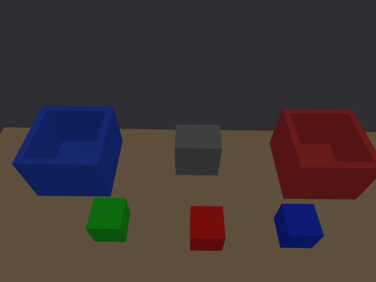
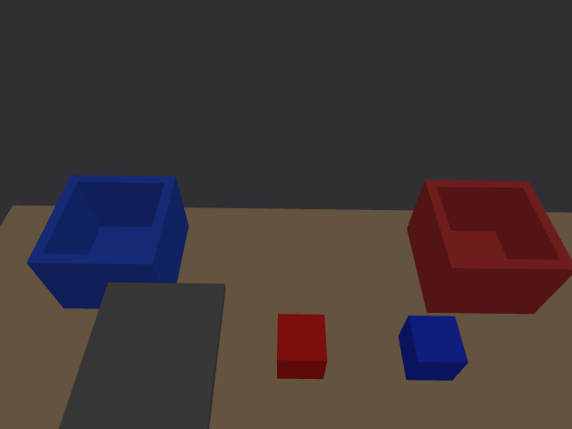

# 难度提升第一阶段 · 2026-10-02

> GitHub 发布说明：本报告原始 `.npz` 帧已移入工作区外的本机归档，未随仓库上传；JSON、报告和截图保留。离线回放需恢复原始帧或重新采集。见 [清理记录](../github_20261002/README.md)。

本轮目标是验证连续重启、遮挡拒绝、持物取消与重置恢复，加入可复现的位置扰动、两处静态障碍和独立传感器压力模式。基线不被覆盖：红/蓝各一个 50 mm 方块入对应盒，绿块不动。

## 改动

- 完整启动新增 `--world PATH`、`--sensor-stress`、`--seed N`。同一 world 同时传给 Gazebo 和 MoveIt 固定几何解析器；新增 `obstacle_*` 静态盒体同步成真实规划碰撞体，动态物体不冒充固定设施。
- `make_scenario.py` 提供 jitter/clutter 配置及随机 seed，保存 world 和来源 SHA256。clutter 7 在原取料点附近扰动红/蓝 XY，加中性障碍两处、降低定向光亮度；未支持任意 yaw 或同色多块。
- 深度压力模式在原生深度进入 D2C 前施加 1 mm 高斯标准差与 5% 随机缺失，保留无效深度、帧、K 和手眼。默认关闭；这是设计的压力输入，不是 Gemini 实测噪声模型。相同 seed 可复现随机流，但启动时序变化仍可能改变物理轨迹。
- 取消/失败状态拒绝重新触发，必须重置；取消不计为工件失败。首段运动前复核新鲜视觉并检查取料点未移动超过 5 mm，避免执行过期计划。Gazebo 真值转换读取规划场景的实际 world→base 变换，移除固定 0.347 m 高度假定。
- `capture_camera_reference.py` 保存实际 CameraInfo、RGB-D 原始数组、时间差、每帧图像时刻的手眼/深度光学 TF 与缺项；读取不写入标定。hardware 标签遇仿真时钟会拒绝，标签本身仍不是设备身份认证。

## 官方依据与真机差异

[Orbbec 官方 Gemini 335 页面](https://www.orbbec.com/products/stereo-vision-camera/gemini-335/) 给出的 2 m 深度 RMSE 指标有特定距离条件，不能外推为本工作区近距离每像素噪声。现未发现连接中的 Orbbec USB 设备，缺少此台设备的 K/D、原始手眼 JSON、真实 TCP 和力/滑移数据，因此没有捏造实测噪声参数。

[Gazebo 官方噪声教程](https://get.gazebosim.org/tutorials?cat=sensors&tut=sensor_noise) 说明的独立高斯扰动属于简化模型；本轮深度压力模式也只验证算法鲁棒性，不能声称模拟了双目相关误差、反光表面、滚动快门或完整 Gemini ASIC 行为。

碰撞障碍位置属于已知 world 配置，不是视觉重建；真机未知障碍、OctoMap 感知和动态避障尚未实现。夹持仍采用双指接触后理想固定约束；增加障碍和深度扰动不等于验证了真实夹持力。后续同色多块须先增加独立 ID/追踪、朝向估计和料盒占用/放置槽位管理。

## 操作

生成独立场景（输出路径须不存在）：

```bash
cd /home/hanhan/Desktop/piper_classify_ws
python3 scripts/tools/make_scenario.py --profile clutter --seed 7 --output /tmp/piper_clutter7.world
bash scripts/reset_classify.sh --world /tmp/piper_clutter7.world --sensor-stress --seed 7
```

等 VISION_READY，按交接中的 start 服务触发；也可启动时添加 `--auto-start`。恢复原始模式：`bash scripts/reset_classify.sh`。原始相机模型和 world 文件保持不变。

采集单位真机参考（需真实相机/机械臂 TF 已启动，在独立真实 DDS domain 加载此工作区）：

```bash
source /opt/ros/humble/setup.bash
source install/local_setup.bash
export ROS_DOMAIN_ID=43
python3 scripts/tools/capture_camera_reference.py --source hardware --output /tmp/gemini_unit_reference --duration 12
```

默认是 RGB 和对齐深度；需要原生深度 K 时应通过 --depth-topic/--depth-info-topic 选择硬件驱动的原生流。缺失外参会记录，不用单位矩阵替代；此工具不自动改写相机模型，非零畸变/主点偏移需要匹配渲染模型后才能导入。

完整无人图形测试（会运动，先停止现有仿真，输出目录须不存在）：

```bash
source /opt/ros/humble/setup.bash
source install/local_setup.bash
export ROS_DOMAIN_ID=42
python3 scripts/tools/verify_robustness.py --output /tmp/piper_robustness_run
```

测试按顺序重建每个场景，最后停止自己启动的仿真。最终结果见下面的验证表和接受汇总。

## 最终验证结果

最终接受记录见 [accepted_summary.json](accepted_summary.json)，共 8 项。受影响的 6 包构建通过；最终相机/任务两包复编通过。`colcon test-result --verbose` 为 **13 tests、0 errors、0 failures**，包含新增深度噪声单位/无效值保留及缺失率可复现检查。相机 FOV、手眼和基线场景静态检查通过。

| 检查 | 结果与证据 |
|---|---|
| 基线重启 A | [实际分拣](runs_v2/baseline_a/batch/record.json) 81.657 s，绿位移 0 mm |
| 基线重启 B | [实际分拣](runs_v2/baseline_b/batch/record.json) 81.407 s，绿位移 0 mm |
| 扰动/障碍/噪声组合 | [实际分拣](runs_v2/clutter_stress/batch/record.json) 80.862 s，绿位移 0 mm |
| 实际相机遮挡后取消 | [恢复记录](recovery_final/summary.json)：灰色遮挡板在 Gazebo 实际遮住绿块；无手臂 action 目标、关节无显著变化；取消后禁止直接重跑 |
| 遮挡持续导致视觉超时 | [恢复记录](recovery_final/summary.json)：约 20 s 检测超时后 FAILED，工件失败数 1；未发送手臂目标，禁止直接重跑 |
| 已持红块时取消 | [恢复记录](recovery_final/summary.json)：取消服务响应 0.003385 s，停止后关节最大变化 0.00008055 rad，仍夹持 red_block，取消不计工件失败 |
| 取消后完整重置 | [初始记录](recovery_final/reset_after_cancel/initial.json)：三块回 world 初始位置，IDLE 0/2、无旧 result、无附着对象、三个颜色新鲜 |
| 最终 GUI 组合场景 | [实体结果](gui_batch_final/record.json) 83.755 s、2/2、绿位移 0 mm、返回 HOME；采用最终二进制与启动配置 |

其中取消响应时间只表示本机 DDS 服务响应，不是工业急停制动时间。停止后的关节变化是在 1 s 等待后继续观察 2 s；未模拟断电、通讯丢失或真实电机力矩。绿色 0 mm 是这几轮仿真采样未见位移，不是物理无限精度。

GUI 轮规划场景位置差：红 0、蓝 0.000791 mm、绿 0.412718 mm；红/蓝由执行结果的实体测量同步，不能当作视觉定位精度。两处障碍的规划/实际位置差均为 0 m，且尺寸与生成配置一致，见 [障碍几何核对](gui_obstacles.json)。

最终采集工具在仿真模式实测保存 6 对 RGB-D、实际 CameraInfo；每对均含图像时刻的三组 TF、无缺项，见 [采集元数据](camera_capture_final/metadata.json)。hardware 标签的仿真时钟拒绝路径也已通过，见 [保护记录](hardware_label_guard/metadata.json)。**没有采到真实单位相机数据**。





测试中取消后仅剩未被任务锁定的绿块/蓝块可重新确认，当前红块继续锁定，因此 scene.ready 不一定恢复 true；这是要求重置的设计。完整重置后所有颜色才重新确认。

## 历史诊断与后续范围

runs/ 是测试工具属性命名冲突导致的初始化失败；runs_v2/ 的前三项成功，第四项因测试错误地要求取消后全场景立即 ready 而失败。已改为检查绿参考重新确认，再独立确认重置后的全场景 ready，recovery_final/ 四项通过。窗口截图曾被桌面前台应用遮挡，已删除不属于仿真的截图；本报告图片仅使用 ROS 相机流。GUI 初始附加几何检查曾忽略 MoveIt object.pose 与 primitive_poses 的组合，检查工具现已修正；实际障碍几何始终与 Gazebo 一致，gui_obstacles.json 已独立核实。保留这些历史，不将失败记录混入接受汇总。

后续顺序：同色多块的独立 ID/多目标关联 → 顶面朝向与抓取姿态 → 料盒槽位与占用 → 真实设备 CameraInfo/TF/重复深度采集 → 基于测量的误差模型与实际夹持验证。现行执行验证仍依赖 Gazebo 真值服务，尚无实机控制/力反馈后端；采集工具可读取真实相机，但当前 start 服务不能直接当真机任务入口。

本轮全部测试进程在结束后停止，用户可按本页命令独立启动验收。
