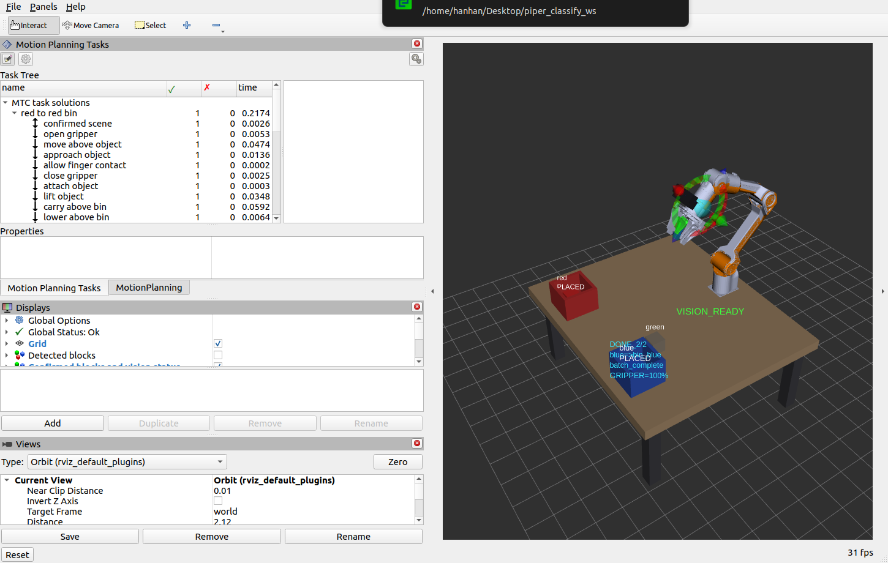
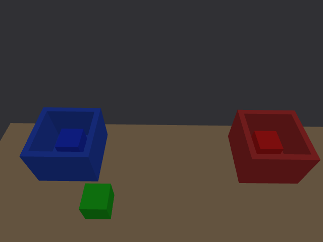

> 后续 2026-10-02 已完成复杂场景、防护与恢复补测，见 [新阶段报告](../robustness_20261002/README.md)。

# 自动分拣闭环与验收 · 2026-10-01

S5/S6 已完成：视觉定位红、蓝块，MTC 规划并执行抓放，分别落入对应盒；绿块保持原位，连续反馈 0/2→1/2→2/2，释放后返回 HOME。四轮完整 Gazebo 闭环通过，包含移位测试。最终 GUI 轮使用当前代码和配置，用户随后亲自运行并确认正常；重置修复及其验收边界见 [重置验证](../reset_20261001/README.md)。完整运行步骤见 [当前交接](../05_交接说明.md)。

## 实现与依据

新增 classify_task C++ 节点、classify_grasp_sim C++ Gazebo 插件、classify_bringup 完整启动包，现有 9 包均可构建。Python 只用于 launch、配置和独立验收。Trigger `/classify/start` 异步接受任务，重复触发拒绝；`/classify/cancel` 请求停止并保持夹爪；状态和结果发布到 `/classify/status`、`/classify/result`。夹爪开口取实际 joint7，持物状态取实际接触约束。

每件 MTC 有 16 阶段：确认场景、张开、到物块上方、接近、允许手指接触、闭合、规划附着、抬升、搬到料盒上方、下降、释放、规划脱离、更新盒内场景、恢复手指碰撞、退回上方、返回 HOME。两件描述与解在 `/classify_mtc/{description,statistics,solution}`，RViz Motion Planning Tasks 可查看。

本机 MTC 0.1.3 负责规划，递归展开 SubTrajectory 后通过 MoveGroupInterface 执行并逐段应用场景差分；差分清除规划缓存关节状态，保持真实控制器反馈。没有安装额外系统包。[旧版官方源码](https://github.com/moveit/moveit_task_constructor/tree/ros2-old) 及本机接口快照 reference/ 是 API 依据，不能直接套用新版教程。

取料中心从已确认的视觉碰撞体取得并变换到 base_link，没有硬编码红/蓝取料 XY。料盒是固定设施，目标由 world 同源的五块几何计算。Gazebo GetEntityState 用于独立检查抬升、释放、落盒和绿块，不生成取料坐标。只有移位测试工具使用 SetEntityState，产品任务没有用它搬运物块。

任务拥有正在夹持和已释放对象；场景桥不会用取料区历史观测把块拉回原位，或把已附着块重新加入世界障碍。入盒块位置取释放后的实体测量，标签为 PLACED。完成后取料区只有绿块，检测缺少红/蓝正常；短暂失效仍如实显示 VISION_UNAVAILABLE。

## 解决的执行问题

1. 后移布局的全程垂直或固定 45° 姿态受 joint5 限位/近桌面 IK 限制。现用抓取/抬升 30°、搬运/入盒 45°，法兰 +Z TCP 0.132 m、预接近 75 mm、抬升 180 mm、释放净空 25 mm。TCP 是碰撞几何设计值，尚非实机标定。
2. 只允许 base_link/table_top 安装接触，保留完整 SRDF AllowedCollisionMatrix。仅发送两项矩阵会替换原矩阵、丢失相邻链接豁免，已修正；运动链接继续碰撞检查。
3. ODE 约 1e−11 的夹爪边界噪声导致 MTC 严格拒绝当前状态；仅对 1e−4 容差内误差收回边界，真实越界仍失败。
4. 移位红块抬升被相对 Cartesian 跳变阈值 1.5 过早拒绝；改为 10、步长 3 mm、完成比例要求 1.0，保留碰撞检查。基线和移位随后通过，不能据此声称任意位姿无关节跳变。
5. 纯 ODE 摩擦抓取实际抬升失败，任务检测后停止。新增插件在开口≤29 mm、两指与同一块的侧面接触持续 50 ms 后建立物理固定约束；开口增大超过 2.5 mm 时解除。物块保持动态，释放后落在盒底，没有瞬移。
6. MTC 名称用 classify_mtc，避免旧版将带斜杠名称变成隐藏话题；保留两件 Task 供面板查看。RViz 改为手动/MTC 页签，默认隐藏重叠预览；Gazebo 查看视角放大到桌面。传感器 FOV 保持不变。

## 实测结果

| 记录 | 用途 | 两件结果 | 耗时 s | 绿块位移 mm |
|---|---|---|---:|---:|
| [batch_contact](batch_contact/record.json) | 首次双指接触约束闭环 | 成功 | 84.305 | 0.000010 |
| [displaced_final](displaced_final/record.json) | 红块先移 x−18 mm、y+30 mm | 成功 | 80.480 | 0.007818 |
| [baseline_final](baseline_final/record.json) | 当前运动参数，GUI | 成功 | 86.433 | 0.001346 |
| [gui_final](gui_final/record.json) | 当前代码与最终 GUI | 成功 | 85.084 | 0.007813 |

最后三轮独立检查：旋转后的两块八角点均在盒内（净宽 106 mm、容差 1 mm）、中心符合盒底高度、绿位移<2 mm、0/1/2 计数、实际夹爪开合、持物红/蓝且不含绿、最终约束解除、实际 HOME 关节误差<0.065 rad、场景无残留附着、两个 MTC 描述和解可观测。首轮早于 MTC 观测断言加入，不把它当该接口的验证覆盖。

最终 GUI 轮实体世界坐标（m）：红 `(0.527386,−0.220215,0.386999)`、蓝 `(0.527043,0.219667,0.386996)`，均落盒底；绿 `(0.399999,0.140000,0.374999)`。规划场景对实体测量的位置差：红 0、蓝 0.0016 mm、绿 0.4820 mm。红/蓝由任务实测同步，绿来自相机，不能把零差称视觉精度。

每轮 task.log 留存视觉目标、实体抬升/落盒及最终汇总；summary.json 为四轮摘要。gui_final/home_rgb.png 是最终 HOME 的真实渲染图，home_vision.json 留存绿块完整顶面检出及 ready=true 的场景状态。截图中 HOME 目标交互标记属于 RViz 手动控制图层。

静态场景、相机模型、启动 bash 语法及工具/launch Python 语法检查通过。已有 C++ 回归：**11 tests，0 errors，0 failures**。9 包构建完成；Gazebo 外部 CMake 有既有开发警告，不影响构建。完整启动停止脚本已实测停止本工作区进程组。当前 GUI 保持最终结果便于验收。

## 诊断记录与限制

friction_trial/ 是纯摩擦失败证据，displaced/ 是旧 Cartesian 阈值失败证据，均为开发历史。rviz_running.png、gazebo_running.png、rviz_done_before_layout.png、rviz_layout_trial.png、rviz_done.png 为布局过程截图；最新为本页的 *_final.png。

双指固定约束是**理想夹持近似**，没有校验真实力、滑移、柔性或真机轨迹。四轮成功及一次小幅移位不是全工作空间、随机位姿或长期可靠性证明。取消/急停恢复不属于此次正常成功路径覆盖；取消保留夹爪，不自动释放。

Gemini 参数、保存手眼矩阵和用户后移布局保留；单位设备 K/D、原始手眼 JSON、真实 TCP 和 depth→RGB 外参仍缺。详见 [Gemini 模型报告](../gemini335_20261001/README.md) 和 [视场复核](../gemini335_fov_20261001/README.md)。本轮成果均为仿真，未修改真机工作区；用户最终验收后再决定实机接入。
